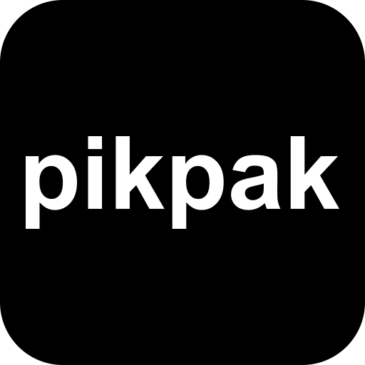

<p align="center">
  
</p>

<h1 align="center">PikPak Personal</h1>

<p align="center">给自己用的 PikPak 桌面直链工具。</p>

<p align="center">
  <a href="https://github.com/li1679/Pikpak2DirectLink/releases/latest">下载桌面版</a>
  · <a href="desktop/README.md">使用与恢复说明</a>
  · <a href="CHANGELOG.md">更新记录</a>
</p>

把磁力链接和 PikPak 分享链接解析成直链或本机代理下载地址。打开独立桌面窗口就能使用，不需要项目注册、管理员密码或订阅。PikPak 账号在应用内添加。

## 下载和开始使用

当前桌面版本：**1.0.1 · Windows x64**。

| 下载 | 使用方式 |
| --- | --- |
| [Windows 安装包](https://github.com/li1679/Pikpak2DirectLink/releases/download/desktop-v1.0.1/PikPak-Personal-1.0.1-windows-x64-setup.exe) | 安装后从开始菜单打开 **PikPak Personal**。 |
| [免安装 ZIP](https://github.com/li1679/Pikpak2DirectLink/releases/download/desktop-v1.0.1/PikPak-Personal-1.0.1-windows-x64-portable.zip) | 解压完整文件夹，双击 `PikPak Personal.exe`。 |

免安装版的 `pikpak-service.exe` 必须与主程序放在同一目录。使用时不需要安装 Go、Rust 或 Node.js，也不用手动配置环境变量和加密密钥。

应用使用 Microsoft Edge WebView2。电脑缺少运行时时，安装器会尝试补装，可能需要联网。当前安装包未进行代码签名。

1. 打开应用，在「PikPak 账号」中添加自己的账号。
2. 在「解析」页粘贴磁力链接或分享链接；多条链接按行输入，需要时填写提取码。
3. 完成后选择文件，复制直链、使用代理下载，或推送到 aria2。

**关闭窗口会停止后台解析和本机代理下载，下载时请保持应用运行。** 重复启动会唤起已有窗口，不会再开一套后台。

## 能做什么

- **链接解析**：支持磁力链接、PikPak 分享链接、提取码、多行批量任务和多文件选择。
- **文件库**：保存资源、用文件夹整理，支持重命名、移动、删除和可撤销的固定下载链接。
- **直链与代理**：取得 PikPak 下载地址，也可通过本机代理下载；代理入口继续校验下载令牌。
- **PikPak 账号池**：管理多个账号，保留凭据刷新、健康检查、会员状态及账号本月流量统计。
- **aria2 推送**：将单个或多个下载任务发送到本机 aria2 RPC，配置保存在应用的浏览器数据中。
- **日志与设置**：查看解析过程，调整并发数量和任务超时，创建和恢复个人数据库备份。

界面只有「解析、文件库、PikPak 账号、日志、设置」五个页面。项目用户、OAuth、订阅、CDK 和在线更新均已移除。

## 数据保存在本机

默认数据目录：

```text
%LOCALAPPDATA%\com.pikpak.personal.desktop\
```

也可通过 **文件 → 打开数据目录** 查看实际位置。账号凭据、会话及资源内容按字段加密保存在 SQLite 中；状态和时间等元数据并非全库加密。应用仍需连接 PikPak 服务来登录、解析和取得下载地址。

加密密钥自动生成，并由当前 Windows 账户的 DPAPI 保护。已有数据库的密钥缺失或损坏时，程序会停止启动，不会生成新密钥覆盖数据。卸载默认保留个人数据。

本版使用新的个人数据库，**不导入原项目的旧数据库、JSON 或文件会话**。没有开机自启、托盘驻留或后台在线更新。

## 备份和恢复

1. 在 **设置 → 数据库备份** 创建快照；默认也会每 24 小时自动备份，保留最近 7 份。
2. 通过 **文件 → 导出恢复密钥** 单独保存密钥，与数据库备份分开保管。
3. 使用 **文件 → 恢复数据库备份** 选择本个人版且密钥匹配的快照，确认后执行恢复。
4. 恢复完成后重新打开应用。恢复前的数据会保留在 `restore-safety/`，快照之后的变更不会进入恢复结果。

**数据库快照不包含加密密钥。** 换电脑或更换 Windows 账户时，需要已导出的恢复密钥。完整目录说明和换机恢复步骤见 [桌面版使用说明](desktop/README.md#备份与恢复)。

## aria2

在页面中填写本机 RPC 地址和密钥，默认地址是：

```text
http://localhost:6800/jsonrpc
```

aria2 需开启 RPC 并允许应用发起请求；下载本机代理或固定链接时，aria2 也应运行在同一台电脑上。这里的“推送”只提交下载任务，不参与应用更新。

## 从源码构建

Windows 桌面构建需要 Go 1.26.10+、Node.js 20+、Rust stable MSVC、Visual Studio C++ Build Tools 和 WebView2。

```powershell
git clone https://github.com/li1679/Pikpak2DirectLink.git
Set-Location Pikpak2DirectLink
npm.cmd --prefix web ci
npm.cmd --prefix desktop ci
.\desktop\build.ps1
```

产物位于 `dist/`。构建脚本会统一生成黑白 `pikpak` 图标、编译前端和 Go 后台，并生成桌面程序及 NSIS 安装包。更多参数见 [桌面构建说明](desktop/README.md#开发构建)。

原命令行服务入口 `cmd/server` 仍保留，配置参考 [.env.example](.env.example)。它需要自行设置稳定的 `DATA_ENCRYPTION_KEY`；桌面版不读取这些服务端环境变量。

检查代码：

```powershell
npm.cmd --prefix web run build
go test ./...
cargo test --manifest-path desktop/src-tauri/Cargo.toml
```

`cargo test` 前需先完成一次桌面构建，使打包所需的后台程序存在。前端依赖先前记录的审计告警尚未在本轮桌面化中升级处理。

## 来源和说明

本项目基于 [MengStar-L/Pikpak2DirectLink](https://github.com/MengStar-L/Pikpak2DirectLink) 改为个人使用的桌面版本，保留原提交历史。

PikPak 接口变化可能影响登录和解析。请只处理自己有权访问的资源，并遵守平台条款和资源版权要求。
